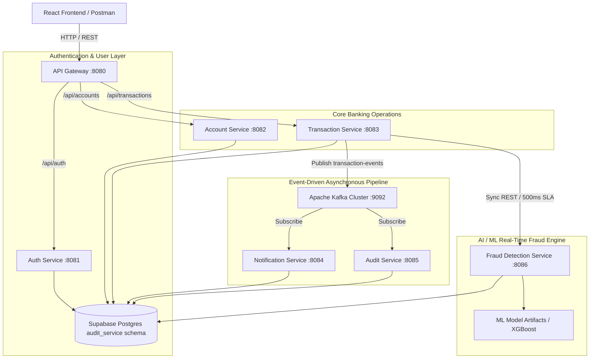
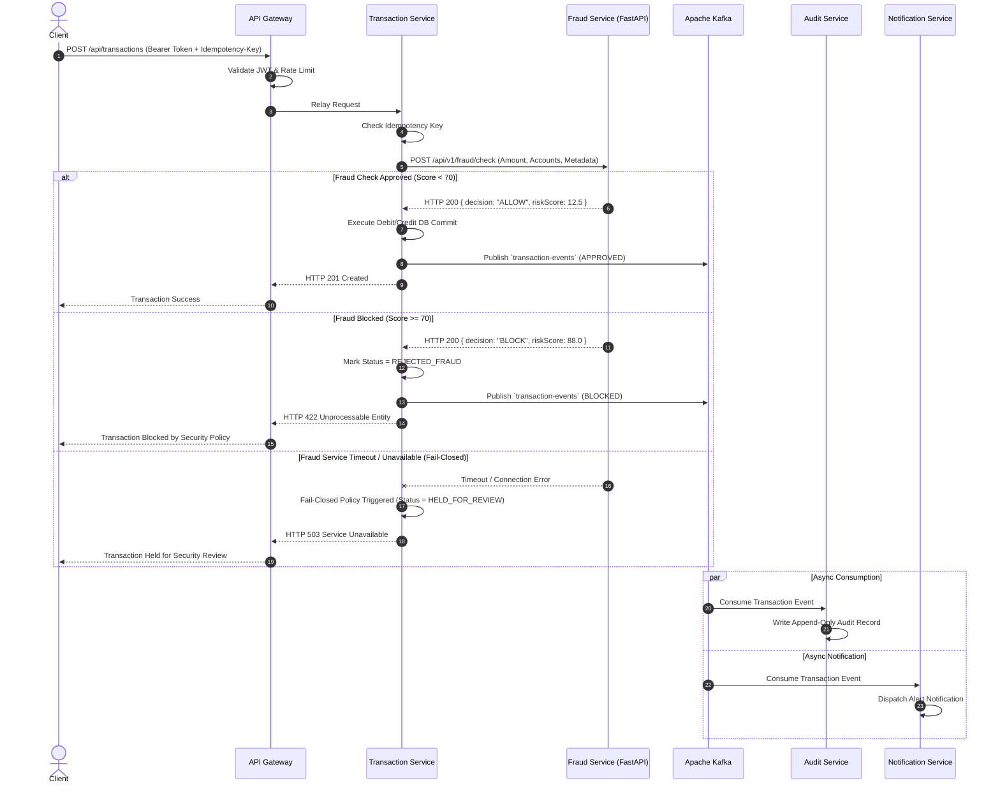

# FinEdge System Architecture & Component Diagram

## 1. High-Level Microservice Topology

## 2. Event Lifecycle & Fail-Closed Transaction Flow

## 3. Database Architecture Trade-Off (Step 22: Supabase Migration)

> [!NOTE]
> **Architecture Decision & Trade-Off Documentation (Viva Flag)**:
> - **Original Requirement**: Strict database-per-service with independent database instances.
> - **Production Cloud Adaptation**: Migrated to a centralized **Supabase Cloud PostgreSQL** instance (`postgres`) using **dedicated per-service schemas** (`auth_service`, `account_service`, `transaction_service`, `notification_service`, `audit_service`, `fraud_service`).
> - **Trade-off Rationale**: Maintaining 6+ physical Supabase project instances creates unnecessary cloud subscription costs and connection pooling overhead for a college/enterprise demonstration project. Logical per-service schemas preserve strict table and search path isolation (`currentSchema=service_name`) while consolidating database administration under a single Supabase project.
